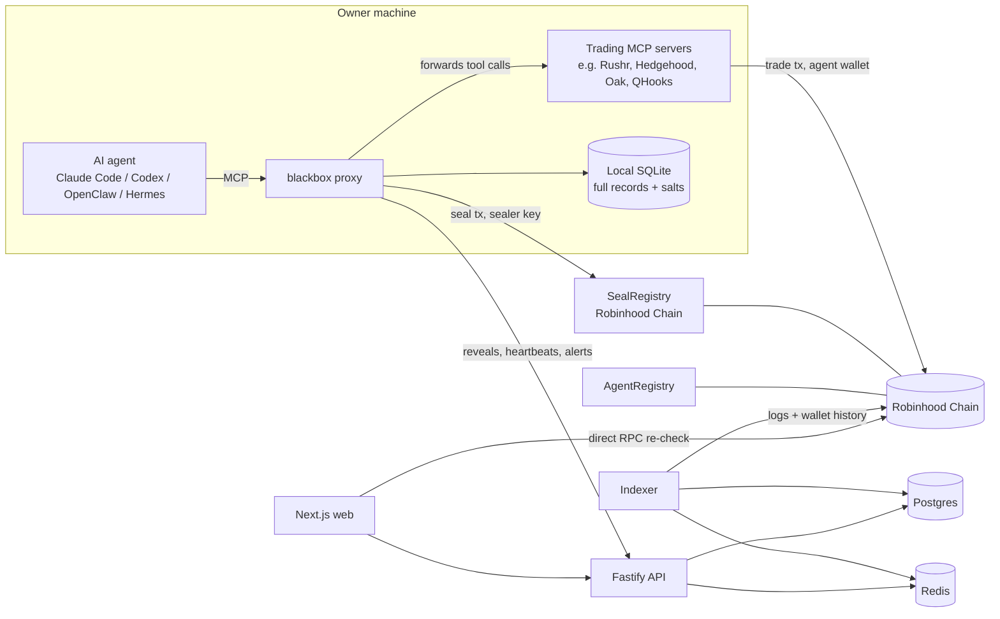

# 02: Architecture and seal protocol

## System overview



## Monorepo

```
apps/
  web/        Next.js 14 App Router. Server components fetch the API; client components for console, charts, replay, verifier.
  api/        Fastify 4. Prisma. REST + SSE. Zod schemas shared via packages/protocol types.
  indexer/    Long-running worker. viem. Cursor per stream stored in Postgres.
packages/
  protocol/   Canonical JSON, keccak leaf, Merkle, verify(). Pure TS, runs in Node and browser.
  recorder/   CLI `blackbox` + MCP proxy + local store.
  contracts/  Foundry. AgentRegistry, SealRegistry, deploy scripts, tests.
```

## The seal protocol (v1)

### 1. Decision record

Every decision the agent makes, including passes, becomes a record:

```json
{
  "v": 1,
  "agentId": "0x…32 bytes",
  "seq": 1842,
  "ts": 1763372520123,
  "kind": "buy",
  "intent": {
    "chainId": 4663,
    "tokenIn": "0x…USDG",
    "tokenOut": "0x…NVDA",
    "amountIn": "412500000",
    "maxSlippageBps": 50
  },
  "asset": { "symbol": "NVDA", "address": "0x…" },
  "context": { "price": "186.20", "volumeVs10d": "1.9", "rsi14": 56 },
  "reasoning": "NVDA reclaimed its 20-day average on volume 1.9x the 10-day mean…",
  "toolCalls": [
    { "name": "get_quote", "args": "0x…keccak(args)", "result": "0x…keccak(result)" }
  ],
  "prev": "0x…leaf of seq 1841 (zero hash for seq 0)"
}
```

- `kind`: `buy`, `sell` or `pass`. Passes have `intent: null`.
- Amounts are integer strings in token base units.
- `toolCalls` carries hashes of arguments and results, not raw data, so the record stays small and private details never need revealing.
- `prev` chains records so any deletion breaks the chain.

### 2. Canonicalization

Serialize with **RFC 8785 JSON Canonicalization Scheme** (sorted keys, no whitespace, UTF-8, numbers in shortest form). Implement in `packages/protocol/canonical.ts` with the RFC test vectors.

### 3. Leaf

```
recordHash = keccak256( utf8( JCS(record) ) )
salt       = 32 random bytes, generated locally per record, stored locally
leaf       = keccak256( 0x00 || salt || recordHash )
```

The salt stops anyone brute-forcing short reasoning from the public leaf. `0x00` is the leaf domain prefix.

### 4. Batching and the Merkle root

- Interior nodes: `keccak256( 0x01 || min(a,b) || max(a,b) )` (sorted pairs, so proofs need no direction bits). Odd node is promoted.
- A batch covers a contiguous `seq` range `[firstSeq, firstSeq + count)`.
- **Trade decisions are sealed immediately** as a batch of one (root = leaf) because the trade must wait for it.
- Passes and other non-trade records are batched every 10 s or 64 records, whichever comes first.

### 5. On chain

`SealRegistry.seal(agentId, root, firstSeq, count)` called by the agent's authorized sealer key. The contract enforces `firstSeq == nextSeq[agentId]` and advances it, so the on-chain sequence has no gaps and no reordering. It emits `Sealed(agentId, root, firstSeq, count)`; the block number of that log is the **seal block**.

### 6. Seal before trade

The proxy holds the trading tool call until the seal transaction is included in a block (poll receipt, target < 1 s on Robinhood Chain, hard timeout 2 s). Then it forwards the call. The trade therefore lands in a block strictly greater than the seal block.

If sealing fails or times out, behavior depends on mode (see `03-RECORDER.md`): `strict` blocks the trade, `lenient` (default) forwards it and marks the decision unsealed. Unsealed trades still count toward returns and lower seal coverage.

### 7. Linking a trade to its decision

The indexer links each trade tx from the bound wallet to a sealed `buy`/`sell` record when all hold:
- trade block > seal block, and trade block − seal block ≤ 150 blocks;
- trade tokens match `intent.tokenIn` / `intent.tokenOut`;
- actual input amount is within `intent.amountIn` ± slippage tolerance.

For unrevealed records the indexer can't see the intent, so the recorder also submits `{seq, leaf, txHash}` links via `POST /v1/recorder/links` right after the trade. The indexer accepts a link only if the tx is from the bound wallet and lands after the seal block. Trades with no valid link are **unsealed**.

### 8. Reveal

`POST /v1/recorder/reveal` with `{record, salt, proof, root}`. The API recomputes the leaf, checks the proof against a `Sealed` event it has indexed, and checks `record.agentId`/`seq` match. Only then is plaintext stored.

### 9. Verification (public)

`verify(input)` in `packages/protocol` returns a list of checks, used by both the API and the browser:

1. Seal exists: leaf → proof → root → `Sealed` log at block B (browser re-reads the log via RPC).
2. Sequence intact: `seq` sits inside the batch range; `prev` matches the previous revealed leaf when available.
3. Sealed before trade: linked trade tx block T > B.
4. Reasoning matches (revealed only): recomputed leaf equals sealed leaf.
5. Wallet bound: tx `from` equals the agent's wallet in AgentRegistry, bound at block ≤ B.
6. Outcome from chain: realized PnL computed from transfers, not from the record.

## Indexer pipeline

| Stream | Source | Writes |
|---|---|---|
| Registry | AgentRegistry logs | `Agent` rows, wallet binding, sealer changes |
| Seals | SealRegistry logs | `SealBatch` rows, sequence gap detection |
| Wallet activity | ERC20 `Transfer` logs to/from each bound wallet + Uniswap v4 swap events | `Trade`, `Transfer` rows |
| Prices | Uniswap v4 pools (USDG pairs) TWAP at each block of interest; daily close snapshot | `Price` rows |
| Metrics | Every 5 min + on new trade | `EquitySnapshot`, `MetricCache`, `RoundTrip` |
| Alerts | Heartbeats + metrics | Telegram messages |

- Cursor per stream in `IndexerCursor`. Handle reorgs by re-reading the last 64 blocks each cycle.
- Live feed: on each new `Sealed` log, publish to Redis channel `feed:seals`; API fans out over SSE.

## Caching

- Leaderboard responses cached in Redis 30 s per filter combination.
- Agent profile cached 15 s; invalidated on new trade or seal for that agent.
